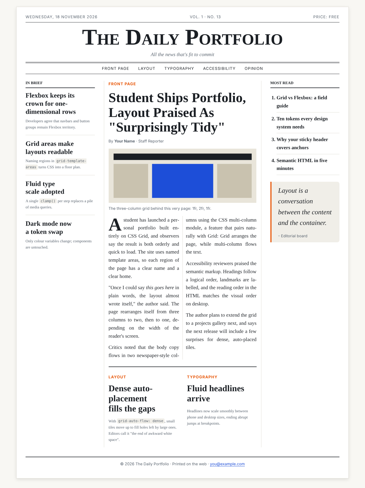
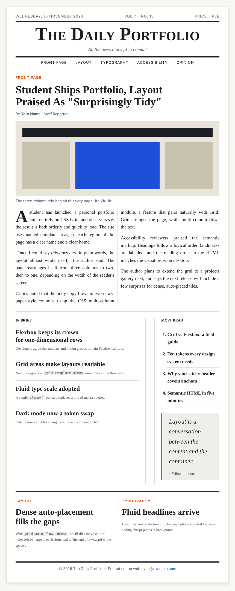
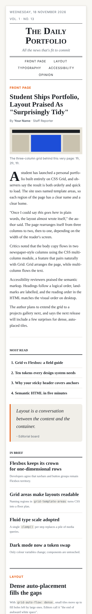

# P11 - Newspaper-style three-column layout with CSS Grid

**Aim:** a front page laid out with `grid-template-areas`.

```css
.grid {
  display:grid; grid-template-columns:1fr 2fr 1fr;
  grid-template-areas:
    "briefs lead      trending"
    "briefs secondary trending"
    "footer footer    footer";
}
```
- Tablet (<=62em): two columns, lead story on top.
- Phone (<=40em): one column.
- Lead text uses CSS multi-column (`column-count:2`, `column-rule`) plus a drop cap; secondary stories are a nested 2-column grid.

**Run:** open `index.html`, resize.

## Output
Desktop:



Tablet:



Mobile:


