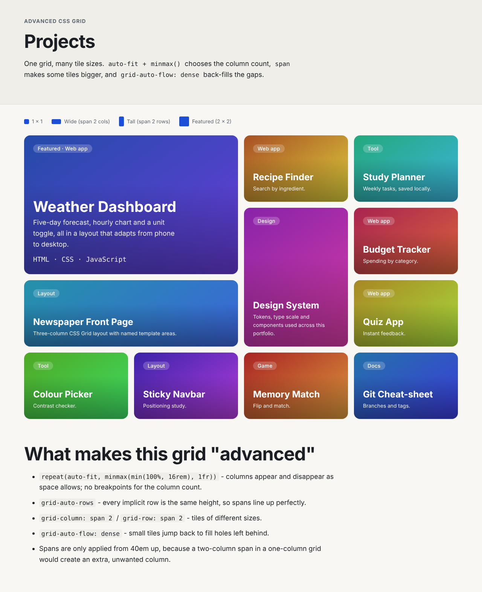
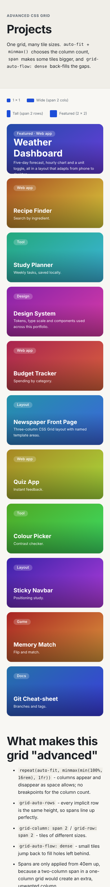

# P12 - Portfolio projects grid with advanced CSS Grid

**Aim:** a gallery with tiles of different sizes that fills itself without gaps.

```css
.grid{
  display:grid;
  grid-template-columns:repeat(auto-fit,minmax(min(100%,16rem),1fr));
  grid-auto-rows:11rem;
  grid-auto-flow:row dense;
}
.tile--wide{grid-column:span 2} .tile--tall{grid-row:span 2}
.tile--featured{grid-column:span 2;grid-row:span 2}
```
Spans are applied only from 40em, because spanning 2 columns in a 1-column grid would create an unwanted implicit column. Tiles are themselves small grids (label top, text bottom).

**Run:** open `index.html`, resize.

## Output
Desktop:



Mobile:


