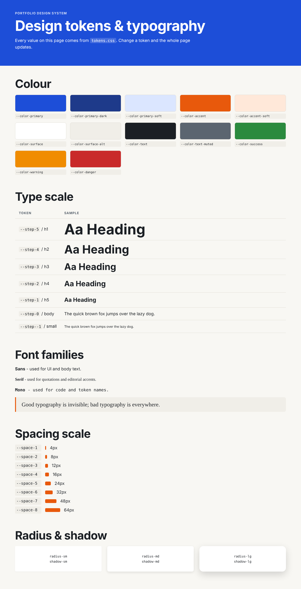

# P7 - Design tokens and typography system in CSS

**Aim:** define every design decision once as a CSS custom property and build the typography from it.

**Files**
| File | Purpose |
|---|---|
| `tokens.css` | Colours, font stacks, fluid type scale (`clamp()`), spacing scale, radius, shadow, z-index layers, dark-mode overrides |
| `base.css` | Reset + heading/paragraph/link/blockquote styles using only tokens |
| `style.css` | Style-guide page layout |
| `index.html` | Style guide showing every token |

**Key code**
```css
:root { --color-primary:#1d4ed8; --space-4:1rem; --step-3:clamp(1.953rem,1.55rem + 2vw,2.441rem); }
h3 { font-size: var(--step-3); }
@media (prefers-color-scheme: dark) { :root { --color-bg:#12151a; /* only colours change */ } }
```
`tokens.css` and `base.css` are reused unchanged in P8-P13.

## Output

